# Introdução

Este repositório documenta testes de autenticação do **FoodExpress**, projeto originalmente desenvolvido por [Daniel Ohata](https://github.com/dr-ohata/foodexpress), utilizado na disciplina de UX/UI e Testes de Software da UniFacens.

A atividade utiliza Supabase para autenticação por e-mail e senha, Postman Desktop para requisições HTTP e GitHub para documentação. Como complemento, foram registrados testes de interface com Selenium IDE.

As evidências disponíveis comprovam o login válido pela API e a execução de cinco cenários na interface. Os cenários inválidos ainda precisam de evidências específicas no Postman para completar os requisitos da atividade.

# Objetivo da Atividade

Aplicar testes de caixa cinza em uma API de autenticação, utilizando conhecimento parcial de sua estrutura: endpoint, headers, corpo JSON e respostas HTTP.

Os objetivos são configurar o Supabase, criar usuários de teste, configurar requisições no Postman, validar status HTTP e respostas JSON, verificar o retorno de token e registrar os resultados obtidos.

# Configuração do Supabase

Foi criado um projeto chamado **FoodExpress** no Supabase. O painel apresenta o projeto, e o provedor Email aparece habilitado na configuração de autenticação. Também foram criados usuários para os testes.

A configuração permite verificar se credenciais válidas geram uma sessão e se entradas inválidas têm o acesso negado. A URL do projeto e a chave da API são utilizadas para conectar o Postman ao serviço de autenticação.

As imagens documentam o estado do ambiente; não registram todas as telas do processo de criação dos usuários.

## Evidências


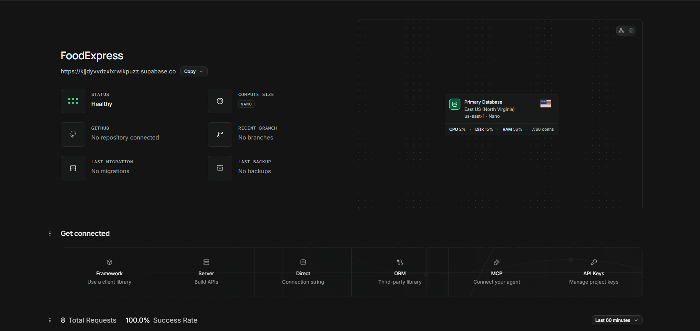

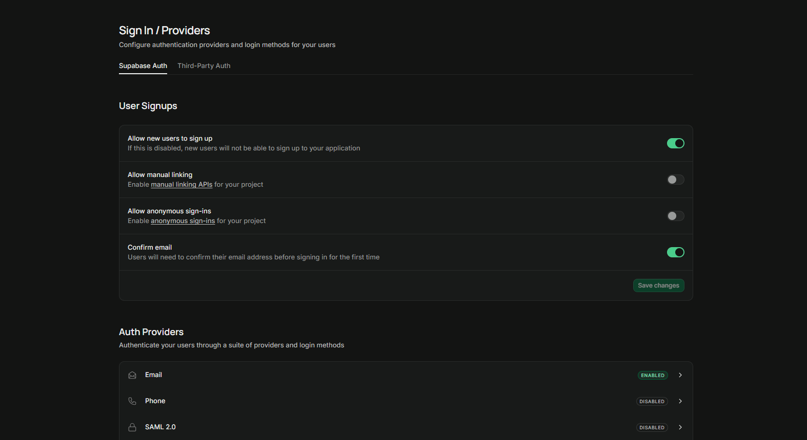

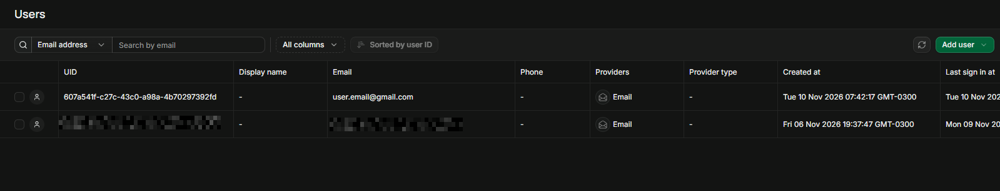


# Configuração do Postman

As evidências mostram o workspace de João Guilherme, uma coleção com a requisição de autenticação e o Environment **FoodExpress**. O ambiente concentra os valores reutilizados nas requisições.

| Variável | Finalidade |
|---|---|
| `base_url` | URL do projeto Supabase |
| `api_key` | Chave de acesso à API |
| `email` | E-mail do usuário de teste |
| `senha` | Senha do usuário; nome utilizado no ambiente registrado |
| `access_token` | Token de acesso associado ao login |

O enunciado solicita a variável `password`. Nas evidências, foi utilizado o nome `senha`. Para padronizar a entrega, é necessário renomear essa variável para `password` e atualizar sua referência no body.

O Postman é utilizado para enviar a requisição e inspecionar status HTTP, resposta JSON e resultados das validações.

## Evidências

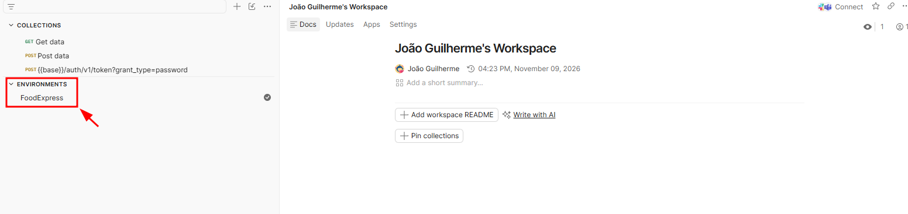


# Configuração das Requisições

A autenticação utiliza o método `POST` no endpoint:

```text
{{base_url}}/auth/v1/token?grant_type=password
```

A finalidade é enviar e-mail e senha ao Supabase e obter uma sessão quando as credenciais forem aceitas.

## Headers

| Header | Valor utilizado no registro |
|---|---|
| `apikey` | `{{api_key}}` |
| `Content-Type` | `application/json` |

O enunciado também exige o header `Authorization`, que não aparece no print dos headers. Sua configuração e evidência permanecem pendentes.

## Body JSON

O corpo registrado utiliza as variáveis do Environment:

```json
{
  "email": "{{email}}",
  "password": "{{senha}}"
}
```

Após padronizar o nome da variável solicitada no enunciado, a referência da senha deverá ser `{{password}}`. O campo JSON continua sendo `password` em ambos os casos.

## Evidências

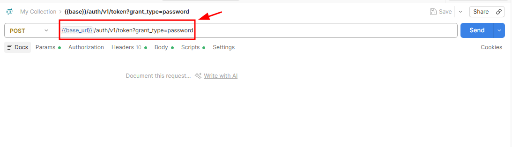

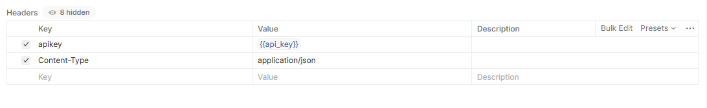

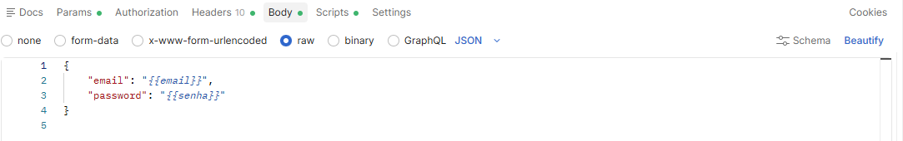

# Execução dos Testes

No Postman, as imagens mostram uma autenticação válida com status `200 OK`, resposta JSON e `access_token`. Também há uma validação de sucesso aprovada e uma execução de validações de erro que falharam ao receber a mesma resposta de sucesso.

No Selenium IDE, foram registrados cinco cenários de interface. A tabela apresenta os resultados visíveis, sem atribuir aos testes de interface resultados HTTP que não foram registrados.

| Cenário | Entrada utilizada | Resultado esperado | Resultado obtido | Status |
|---|---|---|---|---|
| Login válido | E-mail cadastrado e senha correta | HTTP 200 e access token na API; sucesso na interface | Postman retornou 200 e token; Selenium validou o alerta de sucesso | Comprovado na API e na interface |
| Senha incorreta | E-mail correto e senha incorreta | Erro de autenticação e acesso negado | Selenium validou o alerta `Invalid login credentials` | Comprovado na interface; pendente na API |
| Usuário inexistente | E-mail incorreto e senha de teste | Acesso negado | Selenium validou `Invalid login credentials`; a inexistência do e-mail não foi demonstrada separadamente | Evidência parcial; pendente na API |
| Campos vazios | E-mail e senha sem preenchimento | Erro de validação | Selenium concluiu os passos de abertura e clique, sem asserção de mensagem de validação | Validação incompleta |
| Credenciais inválidas | E-mail e senha incorretos | Mensagem de erro e acesso negado | Selenium validou o alerta `Invalid login credentials` | Comprovado na interface; pendente na API |

As entradas da planilha são representadas como `user.email@gmail.com`, `wrong.email@gmail.com`, `user.password` e `wrong.password`. Os resultados da API para entradas inválidas ainda precisam ser registrados com seu status e JSON reais.

## Evidências do Postman


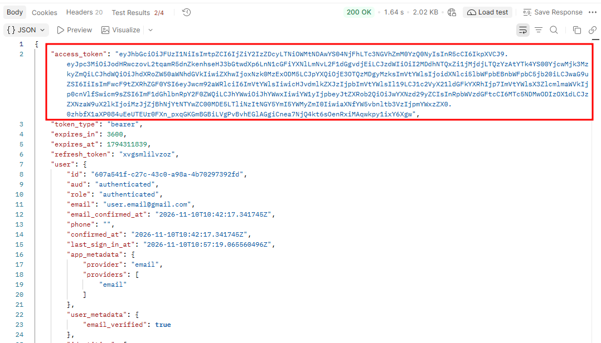


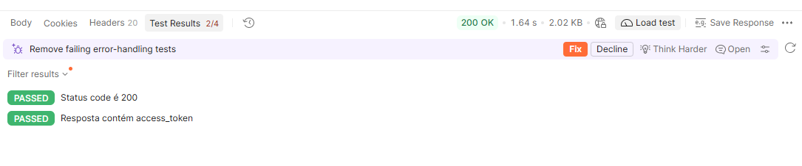

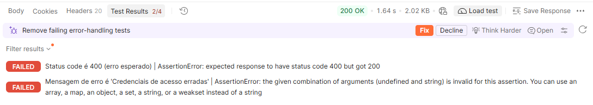

As validações de erro esperavam status 400 e mensagem de credenciais inválidas, mas receberam uma resposta 200. Esse registro mostra uma incompatibilidade entre o cenário enviado e as verificações executadas. As validações devem ser separadas por cenário; não é evidência de rejeição de credenciais inválidas pela API.

## Evidências complementares do Selenium


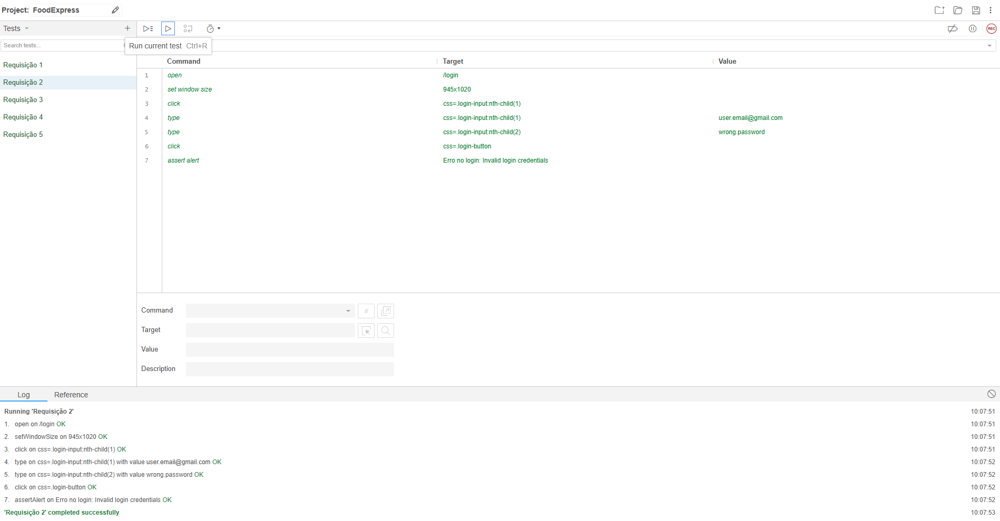


# Registro dos Testes

Os cinco cenários foram registrados na [planilha de testes](planilha/Planilha%20POSTMAN%20%26%20Selenium.xlsx). Cada coluna representa uma requisição, com ID, cenário, entrada de e-mail, entrada de senha, resultado esperado, resultado obtido, status e observações.

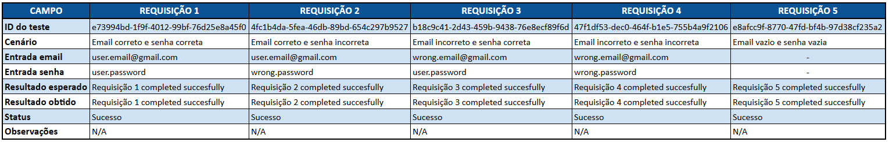

Como exemplo, o registro de senha incorreta utiliza e-mail correto e senha incorreta; o print do Selenium mostra uma asserção do alerta `Invalid login credentials` aprovada.

A planilha marca os cinco registros como `Sucesso` e utiliza mensagens como `Requisição 1 completed successfully` nos resultados. Essas mensagens descrevem a conclusão da execução do Selenium. Para documentar os testes da API, é necessário registrar também o status HTTP e a resposta JSON de cada cenário.

A documentação permite comparar o resultado esperado com o observado e localizar falhas nas verificações. No cenário de campos vazios, a conclusão do script não comprova o erro de validação, pois não há uma asserção correspondente no print.

# Resultados Obtidos

As evidências permitem confirmar:

- Projeto Supabase configurado, provedor Email habilitado e usuários criados.
- Workspace, Environment e requisição de autenticação organizados no Postman.
- Login válido pela API com status `200 OK` e retorno de `access_token`.
- Asserções de sucesso e de credenciais inválidas nos cenários correspondentes do Selenium.
- Registro dos cinco cenários na planilha.

Para concluir os requisitos da atividade, ainda é necessário:

- Executar e registrar no Postman os quatro cenários inválidos, incluindo status HTTP, JSON e mensagens reais.
- Demonstrar que o e-mail usado no cenário de usuário inexistente não está cadastrado.
- Validar explicitamente o resultado de campos vazios.
- Separar as verificações de sucesso e erro no Postman.
- Padronizar a variável `password` e documentar o header `Authorization` exigido.
- Complementar a planilha com resultados específicos da API.
- Criar a pasta `/postman/` na raiz para organizar os arquivos dos testes; atualmente os prints estão em `/prints/postman/`.
- Confirmar que o repositório GitHub está público no momento da entrega.

# Conclusão

A autenticação funcionou no cenário válido documentado: o Supabase retornou status 200 e um token de acesso. Os testes complementares de interface registraram o alerta de sucesso e a rejeição de credenciais incorretas.

A execução ainda não está integralmente comprovada para os cinco cenários de API exigidos. Foram identificadas limitações na documentação dos resultados, nas validações de erro do Postman e na ausência de asserção no teste de campos vazios. Não há evidência suficiente para afirmar uma falha do serviço de autenticação nesses cenários.

As dificuldades pessoais encontradas durante a atividade não foram descritas no material fornecido. O problema técnico visível é a execução de verificações de erro sobre uma resposta de sucesso. Como melhorias, devem ser adotadas asserções específicas por cenário, registros detalhados das respostas e organização dos arquivos do Postman.

Os testes de caixa cinza são importantes porque permitem relacionar o conhecimento do endpoint, dos headers e do JSON ao comportamento observado da API, verificando tanto a geração de uma sessão válida quanto a rejeição de entradas inválidas.
