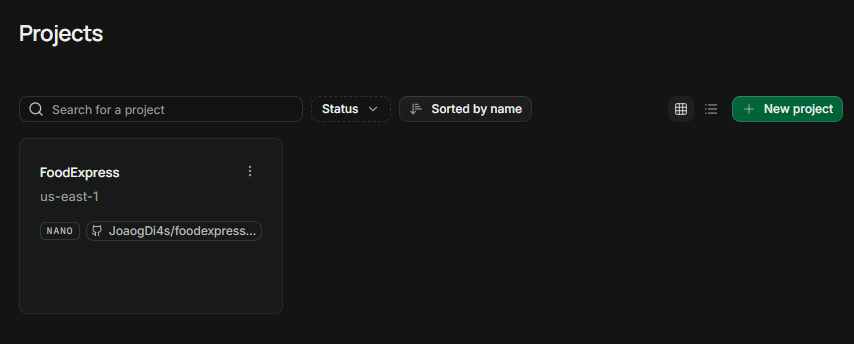
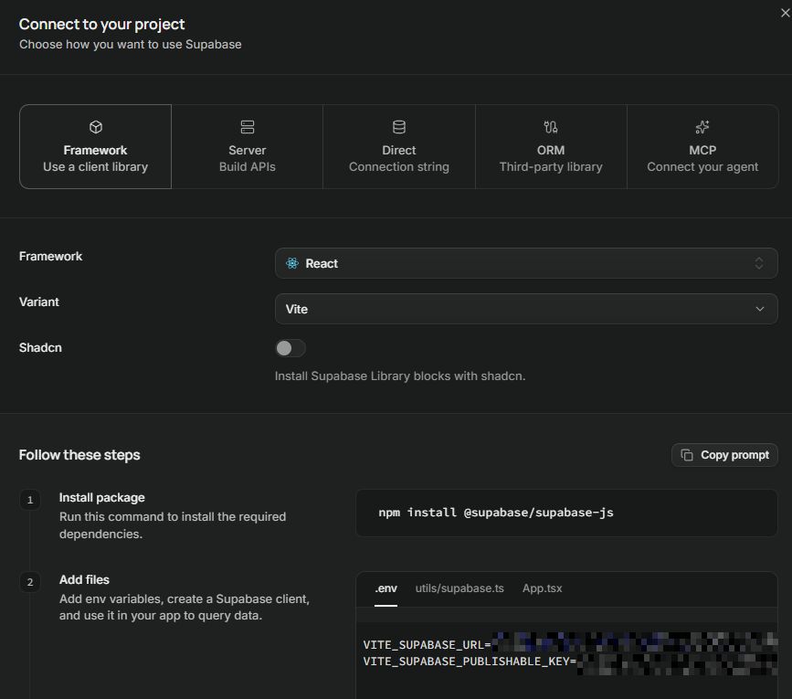
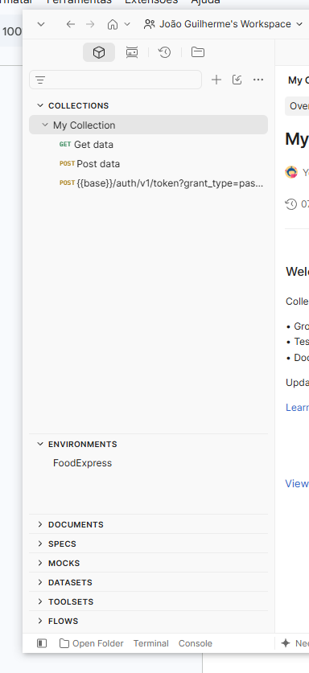
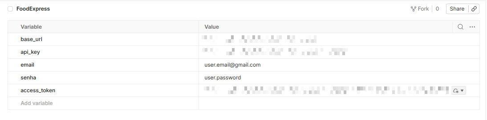
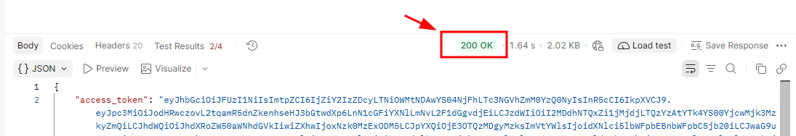
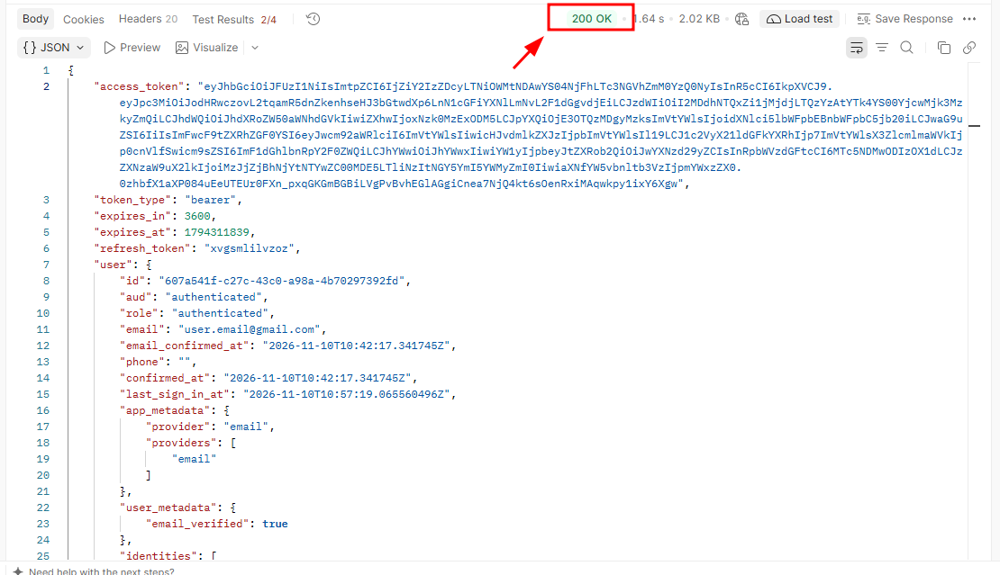
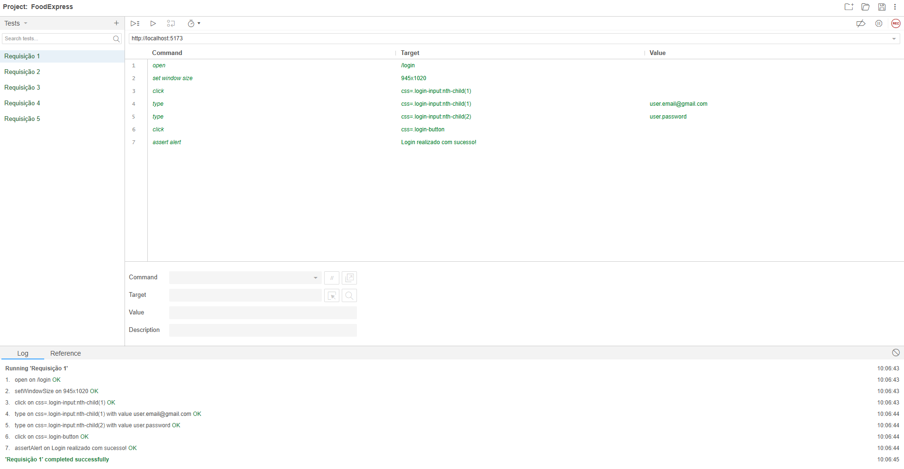
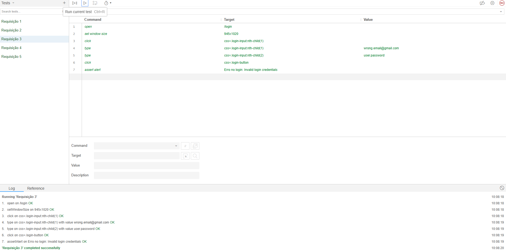
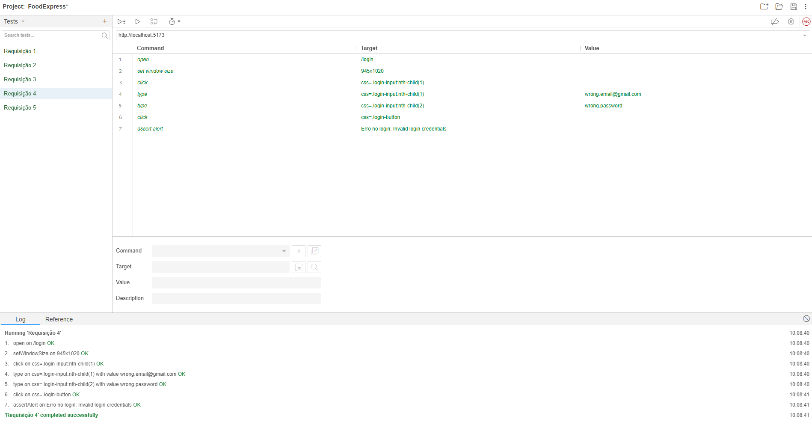
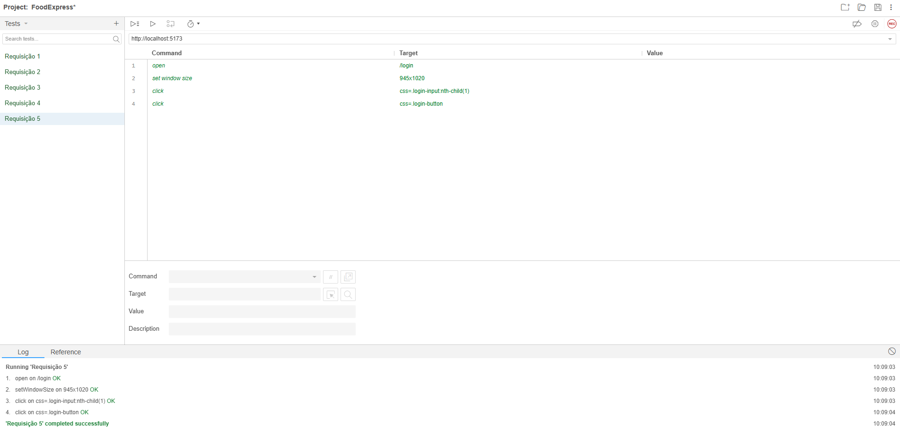

# Introdução

Este repositório documenta testes de autenticação do **FoodExpress**, projeto originalmente desenvolvido por [Daniel Ohata](https://github.com/dr-ohata/foodexpress), utilizado na disciplina de UX/UI e Testes de Software da UniFacens.

A atividade utiliza Supabase para autenticação por e-mail e senha, Postman Desktop para requisições HTTP e GitHub para documentação. Como complemento, foram registrados testes de interface com Selenium IDE.

Foram realizados quatro testes HTTP no Postman, com dois resultados de sucesso e dois de falha, de forma proposital, além de cinco cenários de interface no Selenium IDE.

# Objetivo da Atividade

Aplicar testes de caixa cinza em uma API de autenticação, utilizando conhecimento parcial de sua estrutura: endpoint, headers, corpo JSON e respostas HTTP.

Os objetivos são configurar o Supabase, criar usuários de teste, configurar requisições no Postman, validar status HTTP e respostas JSON, verificar o retorno de token e registrar os resultados obtidos.

# Configuração do Supabase

Foi criado um projeto chamado **FoodExpress** no Supabase. O painel apresenta o projeto, e o provedor Email aparece habilitado na configuração de autenticação. Também foram criados usuários para os testes.

A configuração permite verificar se credenciais válidas geram uma sessão e se entradas inválidas têm o acesso negado. A URL do projeto e a chave da API são utilizadas para conectar o Postman ao serviço de autenticação.

As imagens apresentam o projeto, o painel, a autenticação por e-mail, os usuários e as informações de conexão com a API.

## Evidências






# Configuração do Postman

As evidências mostram o workspace de João Guilherme, uma coleção com a requisição de autenticação e o Environment **FoodExpress**. O ambiente concentra os valores reutilizados nas requisições.

| Variável | Finalidade |
|---|---|
| `base_url` | URL do projeto Supabase |
| `api_key` | Chave de acesso à API |
| `email` | E-mail do usuário de teste |
| `senha` | Senha do usuário; nome utilizado no ambiente registrado |
| `access_token` | Token de acesso associado ao login |

A variável `senha` do Environment é utilizada como valor do campo `password` no corpo JSON da requisição.

O Postman é utilizado para enviar a requisição e inspecionar status HTTP, resposta JSON e resultados das validações.

## Evidências






# Configuração das Requisições

A autenticação utiliza o método `POST` no endpoint:

```text
{{base_url}}/auth/v1/token?grant_type=password
```

A finalidade é enviar e-mail e senha ao Supabase e obter uma sessão quando as credenciais forem aceitas.

## Headers

| Header | Valor utilizado no registro |
|---|---|
| `apikey` | `{{api_key}}` |
| `Content-Type` | `application/json` |

O header `apikey` informa a chave da API, enquanto `Content-Type` identifica o formato JSON do corpo enviado.

## Body JSON

O corpo registrado utiliza as variáveis do Environment:

```json
{
  "email": "{{email}}",
  "password": "{{senha}}"
}
```

O Postman substitui `{{email}}` e `{{senha}}` pelos valores configurados no Environment antes do envio.

## Evidências


# Execução dos Testes

No Postman, foram realizados quatro testes HTTP: dois com resultado 200 e dois com falha, propositalmente. Os prints registram a resposta JSON, o status HTTP, o retorno de `access_token` e os resultados das validações.

No Selenium IDE, foram executadas cinco requisições de teste sobre a interface de login:

| Cenário | Entrada utilizada | Resultado esperado | Resultado obtido | Status |
|---|---|---|---|---|
| Login válido — Requisição 1 | E-mail correto e senha correta | Login realizado com sucesso | Alerta `Login realizado com sucesso!` validado | Sucesso |
| Senha incorreta — Requisição 2 | E-mail correto e senha incorreta | Mensagem de erro de autenticação | Alerta `Erro no login: Invalid login credentials` validado | Sucesso |
| E-mail incorreto — Requisição 3 | E-mail incorreto e senha correta | Acesso negado com mensagem de erro | Alerta `Erro no login: Invalid login credentials` validado | Sucesso |
| Credenciais inválidas — Requisição 4 | E-mail incorreto e senha incorreta | Mensagem de erro de autenticação | Alerta `Erro no login: Invalid login credentials` validado | Sucesso |
| Campos vazios — Requisição 5 | E-mail e senha vazios | Verificar o envio do formulário sem credenciais | Execução com campos vazios e clique no botão de login concluída | Sucesso na execução |

As entradas registradas na planilha são `user.email@gmail.com`, `wrong.email@gmail.com`, `user.password` e `wrong.password`. Na Requisição 5, os dois campos foram deixados vazios.

## Evidências do Postman







Os resultados de falha nas validações foram produzidos propositalmente. O print mostra verificações que esperavam status 400 e mensagem de erro sendo executadas sobre uma resposta 200, permitindo observar o comportamento das asserções quando o retorno é diferente do esperado.

## Evidências complementares do Selenium










# Registro dos Testes

Os cinco cenários foram registrados na [planilha de testes](planilha/Planilha%20POSTMAN%20%26%20Selenium.xlsx). Cada coluna representa uma requisição, com ID, cenário, entrada de e-mail, entrada de senha, resultado esperado, resultado obtido, status e observações.


Como exemplo, o registro de senha incorreta utiliza e-mail correto e senha incorreta; o print do Selenium mostra uma asserção do alerta `Invalid login credentials` aprovada.

A planilha marca os cinco registros como `Sucesso` e utiliza mensagens como `Requisição 1 completed successfully` nos resultados, correspondentes à conclusão das execuções no Selenium.

A documentação permite consultar as entradas utilizadas, comparar os resultados esperados e obtidos e relacionar cada cenário ao seu print de execução.

# Resultados Obtidos

O Supabase foi configurado com autenticação por e-mail e usuários de teste. No Postman, foram organizados o workspace, o Environment e a requisição de autenticação.

O login válido retornou status `200 OK`, dados da sessão em JSON e `access_token`. Os quatro testes HTTP incluíram dois resultados 200 e dois de falha proposital, registrando tanto as verificações aprovadas quanto as reprovadas.

No Selenium, a Requisição 1 validou o alerta de login realizado com sucesso. As Requisições 2, 3 e 4 validaram o alerta de credenciais inválidas. A Requisição 5 foi executada com e-mail e senha vazios. As cinco execuções foram registradas na planilha e possuem prints próprios.

# Conclusão

A atividade permitiu acompanhar a autenticação do FoodExpress por meio de requisições HTTP no Postman e testes de interface no Selenium IDE.

O Supabase retornou uma sessão com token no login válido, e os cenários de credenciais incorretas no Selenium apresentaram a mensagem de erro esperada. Os resultados de falha produzidos propositalmente no Postman permitiram observar como as validações sinalizam diferenças entre o retorno recebido e o esperado.

O registro em planilha e os prints organizados por ferramenta documentam as configurações, as entradas e as execuções realizadas. Os testes de caixa cinza permitem relacionar o conhecimento do endpoint, dos headers e do corpo JSON ao comportamento da autenticação, auxiliando na análise das respostas da API.
